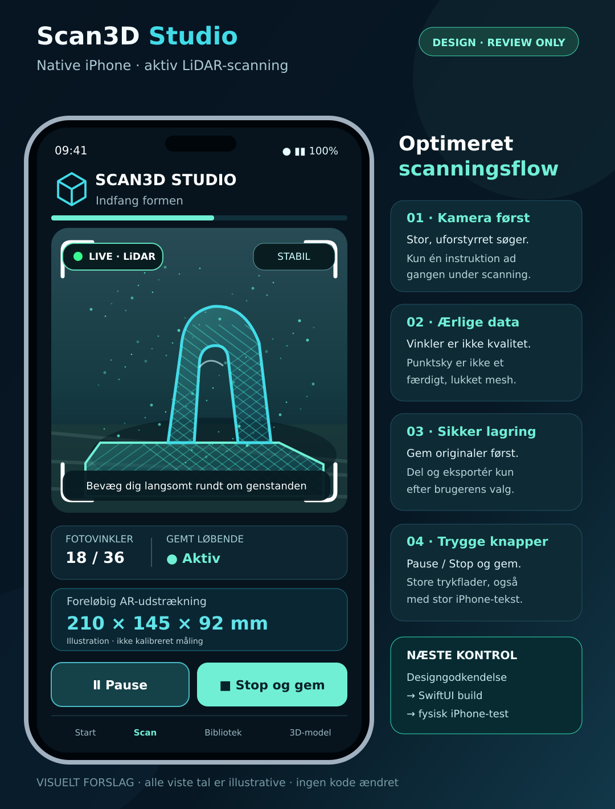

# Scan3D Studio · designoptimering til iPhone (review v0.5)

**Status: Udkast, kun design. Ikke implementeret, merged, deployet eller testet på iPhone.**

## Formål
Forbedr den **native SwiftUI / ARKit** brugeroplevelse på iPhone 14 Pro Max. Byg videre på den faktiske kode i `Scan3DLiDAR/Sources/CaptureStudioView.swift`, `ContentView.swift`, `ScanLibraryView.swift` og på `docs/CAMERA_STUDIO_DA.md`. Ingen ny webapp. Åbn denne PR direkte i GitHub-appen på iPhone; Chrome foretrækkes til browseropgaver.

## Designbeslutninger

1. **Kamera først:** Kameraoptagelsen er største område (cirka halvdelen af højden). Kun én handlingsanvisning i bunden, AR-mål/søger og diskret LIVE-status. Brug ARView, ikke et nyt kamerastream.
2. **Status uden falsk præcision:** Fotovinkler vises som `18/36` eller faktisk antal, aldrig som målt objektdækning i procent. Vejledende AR-akseudstrækning vises kun, når konkrete koordinater findes, med teksten **'Estimat · ikke kalibreret måling'**. Mockuppens millimetertal er illustrative.
3. **Klar tilstand:** Knapper og info skifter efter `ikke klar → klar/låst → scanner → pause → gemt/fejl`. Pause og stop må aldrig skjule, om optagede data er gemt.
4. **Trygge handlinger:** Primærhandling `Pause`; sekundær `Stop og gem`. Kræv en tydelig bekræftelse, hvis stop kan afbryde ufærdig video. En ny AR-session kan ikke automatisk videreføre gammelt koordinatsystem.
5. **Arkiv først:** `Mine scanninger` viser gemte fotos, videoer, punktsky og eksisterende eksportfiler uden at ændre originaler. Vis filkontrol/SHA-256 ved åbning og fejl uden datatab.
6. **3D uden illusioner:** Gemte PLY-punktskyer er punkter, OBJ-mesh er trekanter og evt. huller. En lukket, printklar STL og egentlig fotogrammetri er fremtidige funktioner, ikke dokumenteret færdige.
7. **Tilgængelig:** Dynamisk tekststørrelse, VoiceOver-etiketter, minimum ca. 44 pt trykflader, portræt/landskab uden afskæring, ordentlig kontrast i dagslys.

## Anbefalet informationsarkitektur

| Skærm | Primær handling | Kun når faktisk klar |
| --- | --- | --- |
| Start | Ny scanning / Mine scanninger | Projektoversigt |
| Scan | Lås mål, automatisk foto, video, Pause / Stop | LIVE LiDAR, kvalitet, fejlforklaring |
| Resultat | 3D-visning og Del | Kontrolleret gemt PLY/OBJ |
| Bibliotek | Åbn og organisér projekter | Foto/video/PLY/OBJ og validering |
| Redigering (senere) | Ændr visning / vælg efterbehandling | Ingen løfter om mesh-reparation endnu |
| Eksport | PLY/OBJ nu, STL/3MF efter implementering | Eksport skal godkendes ved rigtig test |

## Godkendelsesgate før implementering

- [ ] Design gennemgået på iPhone i GitHub-appen (skærmbillede er et mockup, ikke appen).
- [ ] Sammenlign skærmindhold med aktuelle `CaptureStudioView`-tilstande; knapper må ikke love funktionalitet, der ikke eksisterer.
- [ ] Dokumentér 3 tilstande: scanning, fejl/afbrydelse og gemt resultat.
- [ ] Simulator-UI-test: portræt, landskab, stor tekst, VoiceOver-labels, navigation og pause/stop.
- [ ] Native build på præcis commit; signer IPA særskilt.
- [ ] Fysisk iPhone 14 Pro Max: camera/LiDAR tracking, gemning, genåbning, ingen datatab, nøjagtighedsbegrænsning.

**Sikkerhed:** Kun designfiler i denne PR. Ingen `Swift`- eller workflowfiler, `main`, eksisterende scanninger, deploy eller signering ændres. Den aktuelle native PR #29 og Windows-installations-PR #25 forbliver uændrede.
