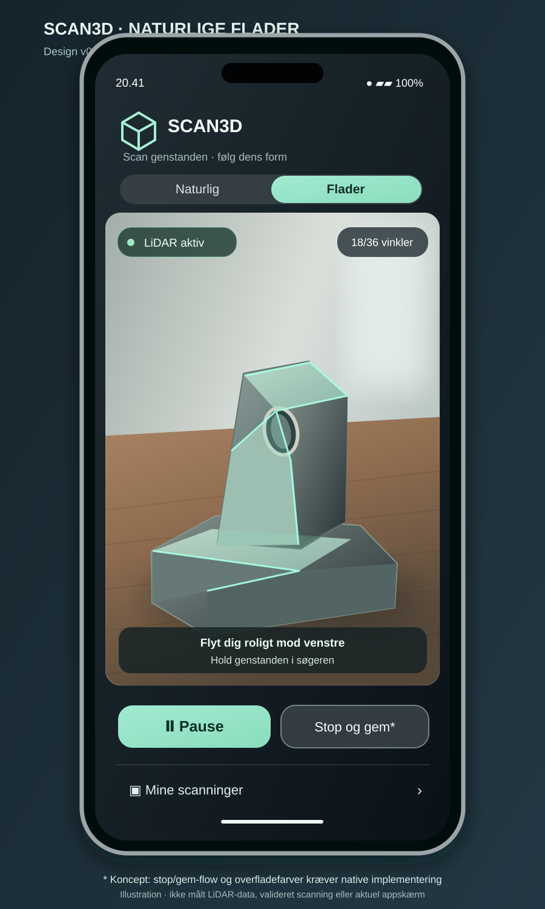

# Scan3D Studio — naturlige LiDAR-overflader · design v0.6

**Status 21. november 2026: designforslag på separat PR-gren. Ikke implementeret i SwiftUI, ikke sammenflettet og ikke fysisk valideret.**

## Hvad oplevelsen skal være
Brugeren skal se **den virkelige genstand**, ikke et neonfarvet trådnet. Kameraet fylder mest. Flader med forskellige retninger får en diskret grøn toning, og større vinkelbrud får tynde konturer. Enkelt budskab: **"Flyt dig roligt mod venstre"**. Ingen teknisk overflod under selve optagelsen.

## Tre forskellige ting, der ikke må forveksles
1. **Naturlig:** ARKit-kamerabilledet uden farvet geometri. Dette er allerede teknisk muligt i den eksisterende app.
2. **Flader (nyt, kræver kode):** transparens-/lyseffekt på *faktisk observerede* ARKit-meshflader efter den beregnede normalretning samt konturer ved betydelige vinkelforskelle. Ingen kunstigt opfundne flader, skjulte områder eller manglende geometri udfyldes.
3. **Trådnet (diagnose):** eksisterende `ARView.DebugOptions.showSceneUnderstanding` – Apples dybdefarvede wireframe. Den er debugvisualisering og må ikke præsenteres som den nye naturlige fladevisning.

## Forslag til native implementation
- Bevar **præcis én** eksisterende `LiDARCameraView` og ARSession. Ingen ekstra kamerasession, ingen anden videostream.
- Brug `ARMeshAnchor.geometry` med faktiske `vertices`, `faces` og `normals`; ved normalforskel mellem naboflader kan der tegnes en diskret, tynd kant. Start med forsigtig skygge og kontur. Tærskel og lys skal tilpasses efter fysisk test, ikke antages at være nøjagtig.
- Overlays skal knyttes til AR-ankre og opdateres/nedlægges med dem. Filtrér ustabile flader; ingen overlay hvor ARKit ikke leverer troværdig geometri. Undgå at gøre nabooverflader til falske, målt korrekte plane flader.
- Farver: afdæmpet minttone med lav opacitet, naturlig lyssætning bevaret fra kameraet. Ingen fuld neonpolygonisering; ingen dristige måle-/dækningsprocenter.
- Primært valg **Naturlig / Flader** ved toppen af søgeren; diagnostisk Trådnet skjult under Indstillinger. Skift visning uden at nulstille eller opgive scanning.
- Korte hjælpetekster ved kamerabund. Dybde utilgængelig → vis naturlig kameravisning og en tydelig tekst, ikke en opdigtet mesh.
- Vinkler vises som faktiske gemte fotopositioner, f.eks. `18/36` **kun når det er de faktiske data**. Ingen procentscore for overfladedækning.
- `Pause` og `Stop og gem` i mockuppet er *mål for designet*, ikke allerede implementerede løfter. Native stop/gem kræver sikker håndtering af aktiv video, datakø og projektmanifest.

## Små, afgørende tests før merge
1. Simuleret UI: naturlig vs. flader vs. manglende geometri, store tekststørrelser, portræt/landskab, min. 44 pt trykflader.
2. Ægte iPhone 14 Pro Max: plan/skrårampe/hjørne, mørk/mat overflade og hul; konturer følger målte AR-mesh-data, ikke fotopixels alene.
3. Kamera- og punktsky-filer forbliver identiske ved skift af visning. Ingen ekstra ARSession; ingen ændring i PLY/OBJ.
4. Framerate, termisk tilstand og batteri skal måles på fysisk telefon; ved overbelastning slås overfladeskygning fra uden at stoppe lagring.
5. Afbrydelser: pause, baggrund, tabt tracking, genstart og Gem under aktiv video uden datatab.

## Eksisterende kode og kilder
- `Scan3DLiDAR/Sources/CaptureStudioView.swift` – faktisk SwiftUI, guidance og kvalitet.
- `Scan3DLiDAR/Sources/ContentView.swift` – ARView, nuværende `showWireframe` debugoverlay.
- `Scan3DLiDAR/Sources/ScanEngine.swift` – ARKit frames, målt dybde og låst mål.
- Apple: https://developer.apple.com/documentation/ARKit/visualizing-and-interacting-with-a-reconstructed-scene
- Apple: https://developer.apple.com/documentation/arkit/armeshgeometry/normals
- Apple: https://developer.apple.com/documentation/realitykit/arview/debugoptions-swift.struct/showsceneunderstanding

**Afgrænsning:** Kun designfiler i PR #31. Ingen ændringer af `main`, testworkflows, signering, scannerlogik eller brugerdata.